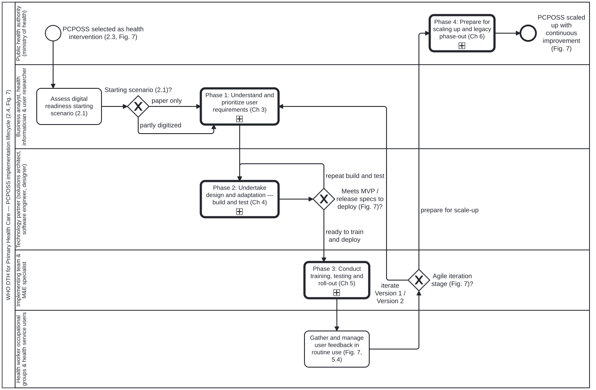

# PCPOSS four-phase implementation lifecycle and agile iteration loop

Formal BPMN 2.0 model of the handbook's top-level four-step approach (section 2.4, Fig. 7, `sec-010`), starting-scenario assessment (section 2.1, `sec-007`), team formation (section 2.2, `sec-008`), and alignment with the broader digital health context (section 2.3, `sec-009`).

## Structure of the model (`Process_PcpossImplementationLifecycle`)

1. **Preparatory activities (sections 2.1–2.3):**
   - `Task_2_1_AssessStartingScenario` (*2.1 Assess starting scenario*): Evaluates facility digitization and infrastructure readiness.
   - `GW_StartingScenario` (*Starting scenario?*): Bound to [`starting-scenario.dmn#Decision_StartingScenario`](../../../processes/decisions/starting-scenario.dmn), branching between `"paper only"` (`Task_2_1a_PaperOnlyPreparation`) and `"partly digitized"` (`Task_2_1b_PartlyDigitizedAudit`).
   - `Task_2_2_FormTeam` (*2.2 Form multidisciplinary implementing team*) and `Task_2_3_AlignDigitalHealthContext` (*2.3 Align with national digital health strategy and DIIG phases*).
2. **Four phases as sub-process `callActivity` nodes (section 2.4):**
   - `Call_Phase1_Requirements` → calls [`Process_UnderstandUserRequirements`](../ch03-understanding-user-requirements/bp-understand-user-requirements.bpmn) (Chapter 3).
   - `Call_Phase2_DesignAdaptation` → calls [`Process_DesignAndAdaptation`](../ch04-design-and-adaptation/bp-design-and-adaptation.bpmn) (Chapter 4).
   - `Call_Phase3_TrainingTestingRollout` → calls [`Process_TrainingTestingAndRollOut`](../ch05-training-testing-and-roll-out/bp-training-testing-and-roll-out.bpmn) (Chapter 5).
   - `Call_Phase4_ScaleUp` → calls [`Process_ScaleUp`](../ch06-scale-up/bp-scale-up.bpmn) (Chapter 6).
3. **Agile iteration loop across MVP, Version 1 and Version 2 (Fig. 7):**
   - `GW_AgileIterationLoop` loops from Phase 3 roll-out feedback back to `GW_Phase1Entry` to refine requirements, design, testing and deployment across successive releases (`MVP → Version 1 → Version 2`) before entering Phase 4 national scale-up, and `GW_ScaleUpFeedback` routes scale-up feedback back into the lifecycle when further iteration is required.
4. **Inputs and outputs chaining:** Each phase's `<bpmn:ioSpecification>` records the exact inputs and outputs from the four chapter summary panels (`sec-011`, `sec-020`, `sec-025`, `sec-029`), with each phase's outputs feeding the next phase's inputs.
