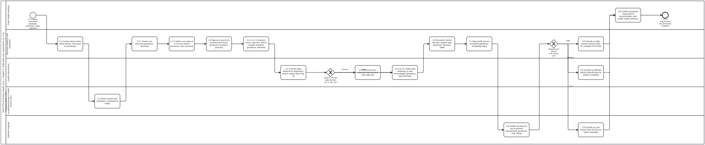

# Phase 1: Understanding user requirements (Chapter 3)

Formal BPMN 2.0 model of Chapter 3 (sections 3.1 to 3.8, `sec-011`–`sec-019`), in which each step produces a WHO SMART Guidelines Digital Adaptation Kit (DAK) component (`smart-base` DAK block kind).

## Steps and DAK artefacts produced (`Process_UnderstandUserRequirements`)

| Step | BPMN Node | Handbook Section & Annex | DAK Block Kind Produced |
|---|---|---|---|
| 3.1 | `Task_3_1_IdentifyStakeholders` | 3.1 Identify and engage stakeholders (`sec-012`) | Stakeholder map & engagement plan (`persona`) |
| 3.2 | `Task_3_2a_ObservationsAndInterviews`, `Task_3_2b_CreateUserPersonas` | 3.2 Gather insights & create user personas (`sec-013`, Annexes 2–4) | `persona` (`smart-base:Persona`) |
| 3.3 | `Task_3_3_MapBusinessProcesses` | 3.3 Map business processes and workflows in BPMN (`sec-014`, Annex 6) | `business-process` (`smart-base:BusinessProcess`, `omg-2013-bpmn-2-0-2`) |
| 3.4.1–3.4.3 | `Task_3_4_1_InventoryPaperForms`, `Task_3_4_2_MapFormDataElements`, `Task_3_4_3_MapAggregateIndicators` | 3.4.1–3.4.3 Paper forms, data elements & aggregate indicators (`sec-015`, Annexes 7–9) | `indicator` (`smart-base:Indicator`) & candidate `data-element` list |
| 3.4.4 | `GW_KeepDataElement` → `Task_3_4_4_RetainDataElement` / `Task_3_4_4_RemoveDataElement` | 3.4.4 Data-element minimization decision tree (Fig. 12, `sec-015`) | Evaluated by [`keep-data-element.dmn#Decision_KeepDataElement`](../../../processes/decisions/keep-data-element.dmn) |
| 3.4.5 | `Task_3_4_5_CompileDataDictionary` | 3.4.5 Core data dictionary with ICD-11, LOINC, SNOMED-GPS, ICHI, ICF bindings (`sec-015`, Annex 10) | `data-element` (`smart-base:DataElement`) |
| 3.5 | `Task_3_5_CreateUserStories` | 3.5 Create user stories (`sec-016`, Annex 5) | `user-scenario` (`smart-base:UserScenario`) & `functional-requirement` |
| 3.6 | `Task_3_6_DecisionSupport` | 3.6 Define decision-support logic (`sec-017`, Annex 11) | `decision-table` (`smart-base:DecisionTable`, `omg-2024-dmn-1-5`) |
| 3.7 | `Task_3_7_SchedulingLogic` | 3.7 Define scheduling logic (`sec-018`, Annex 12) | `scheduling-logic` (`smart-base:SchedulingLogic`) |
| 3.8 | `Task_3_8_NonFunctionalRequirements` → `GW_RequirementPriority` | 3.8 Define NFRs & prioritize requirements (`sec-019`, Annex 13) | `non-functional-requirement` & prioritized backlog via [`requirement-priority.dmn#Decision_RequirementPriority`](../../../processes/decisions/requirement-priority.dmn) |

## Comparison with `smart-base` `l2-dak-authoring.bpmn` and `cat-harness` `crdm-requirements-definition.bpmn`

1. **Comparison with `smart-base/methodologies/processes/l2-dak-authoring.bpmn`:**
   - `l2-dak-authoring.bpmn` models global/national L2 DAK authoring from clinical guidelines into the nine DAK components (health interventions, generic personas, user scenarios, business processes, core data elements, decision-support logic, scheduling logic, indicators, functional & non-functional requirements).
   - `understand-user-requirements.bpmn` adapts that same DAK component sequence for a **country PCPOSS implementing team** starting from field observations (3.2) and facility paper registers/forms (3.4.1–3.4.4) while adapting global WHO DAKs (`sec-011` through `sec-019`).
2. **Comparison with `cat-harness/processes/sdlc/crdm-requirements-definition.bpmn`:**
   - Both processes operationalize the Public Health Informatics Institute (PHII) **Collaborative Requirements Development Methodology (CRDM)** (cited in PHC refs. 20 and 50): current-state business process analysis → task/workflow redesign → data and functional requirement derivation → stakeholder validation and prioritization (`High` / `Medium` / `Low` = `Must` / `Should` / `Nice-to-have`, aligned with RFC 2119 / RFC 8174 `SHALL` / `SHOULD` / `MAY`).
