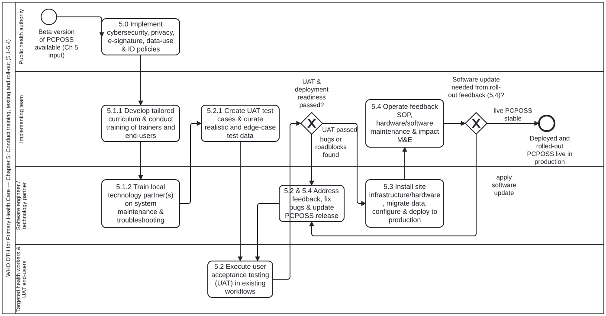

# Phase 3: Training, testing and roll-out (Chapter 5)

Formal BPMN 2.0 model of Chapter 5 (sections 5.1 to 5.4, `sec-025`–`sec-028`), covering pre-roll-out governance policies, parallel user and maintenance training tracks, User Acceptance Testing (UAT), production deployment, and the ongoing feedback and maintenance loop.

## Structure of the model (`Process_TrainingTestingAndRollOut`)

1. **Governance policies and SOPs (5.0, `sec-025`):** `Task_5_0_EstablishPolicies` establishes data-privacy, security, device-management and clinical governance SOPs prior to facility roll-out.
2. **Parallel training tracks (5.1, `sec-026`):** `GW_ForkTraining` splits into:
   - `Task_5_1_1_TrainUsersAndToT` (*5.1.1 Training on use of PCPOSS & training of trainers*) for health workers, clerks and supervisors.
   - `Task_5_1_2_TrainMaintenance` (*5.1.2 Training on maintenance of PCPOSS*) for local IT support and system administrators.
3. **User Acceptance Testing (5.2, `sec-027`):**
   - `Task_5_2_1_PrepareUAT` prepares UAT test cases and synthetic test data (`smart-base:TestScenario`, aligned with `cat-harness` `test-plan-execution.bpmn`).
   - `Task_5_2_2_ExecuteUAT` executes UAT with representative health workers, clerks and supervisors.
   - `GW_UATPassed` routes defects to `Task_5_2_3_RemediateUATDefects` until UAT passes.
4. **Production deployment and feedback loop (5.3–5.4, `sec-028`):** `Task_5_3_DeployToProduction` deploys the PCPOSS in pilot/roll-out facilities and `Task_5_4_FeedbackAndMaintenance` operates the helpdesk, supervisory support and continuous feedback loop.
