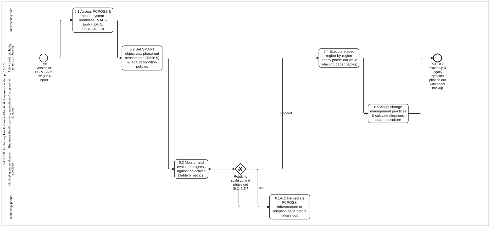

# Phase 4: Scale-up (Chapter 6)

Formal BPMN 2.0 model of Chapter 6 (sections 6.1 to 6.5, `sec-029`–`sec-033`), governing readiness assessment, SMART objectives and Table 5 benchmarks, progress monitoring, staged phase-out of legacy paper systems with paper backup SOPs, and long-term change management and electronic data-use culture.

## Structure of the model (`Process_ScaleUp`)

1. **Readiness assessment (6.1, `sec-029`):** `Task_6_1_AssessReadiness` evaluates political, financial, infrastructure, workforce and technical readiness across target regions.
2. **SMART objectives and Table 5 benchmarks (6.2, `sec-030`):** `Task_6_2_DefineSMARTObjectives` sets measurable scale-up targets and benchmark thresholds (Table 5).
3. **Monitoring progress and readiness gateway (6.3, `sec-031`):**
   - `Task_6_3_MonitorProgress` measures facility performance, user adoption and data quality against Table 5 benchmarks.
   - `GW_ReadyToScaleUp` (*Ready to scale up?*) is bound to [`ready-to-scale-up.dmn#Decision_ReadyToScaleUp`](../../../processes/decisions/ready-to-scale-up.dmn): when `"not"`, `Task_6_3a_RemediateReadinessGaps` addresses infrastructure, training or software gaps and re-monitors; when `"proceed"`, scale-up proceeds.
4. **Staged legacy phase-out and paper backup SOPs (6.4, `sec-032`):** `Task_6_4_PhaseOutLegacySystems` conducts staged retirement of duplicate paper registers while retaining standardized paper backup forms and SOPs for power or connectivity outages.
5. **Change management and electronic data-use culture (6.5, `sec-033`):** `Task_6_5_ChangeManagementAndDataUse` institutionalizes routine electronic data review, supervisory feedback and peer learning by health workers and facility managers.
