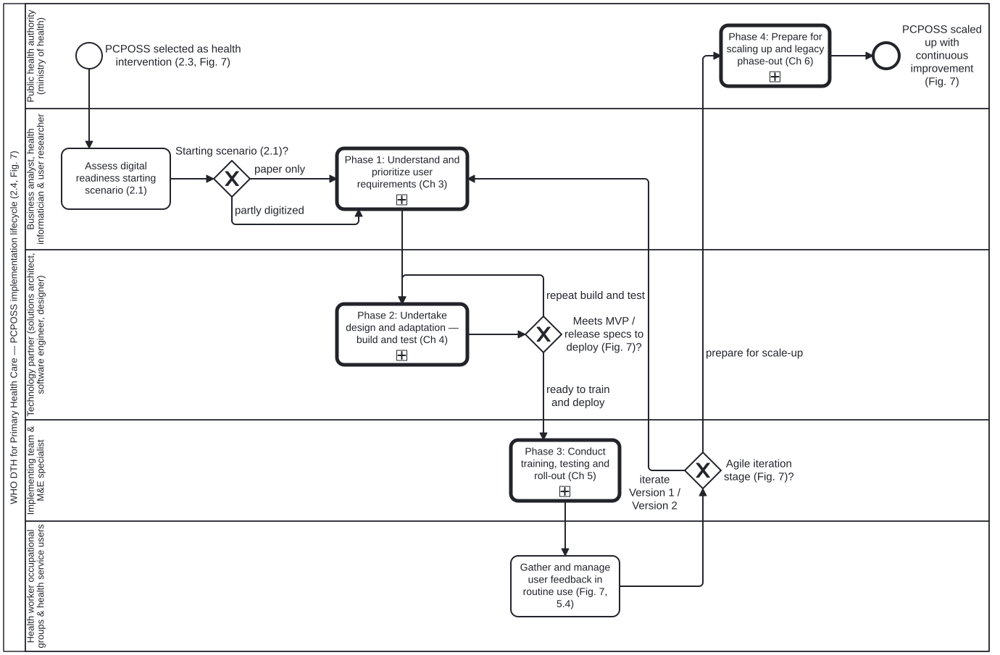
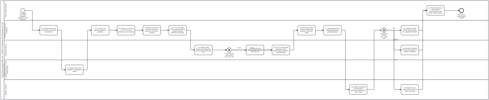
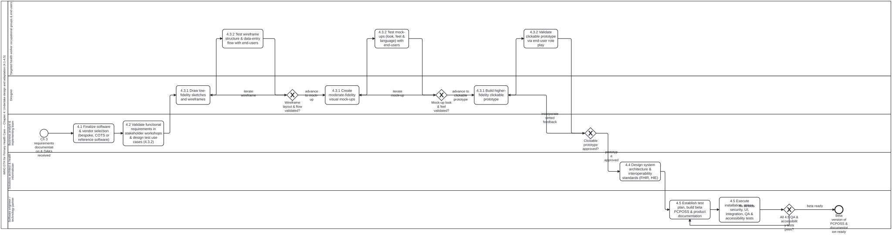
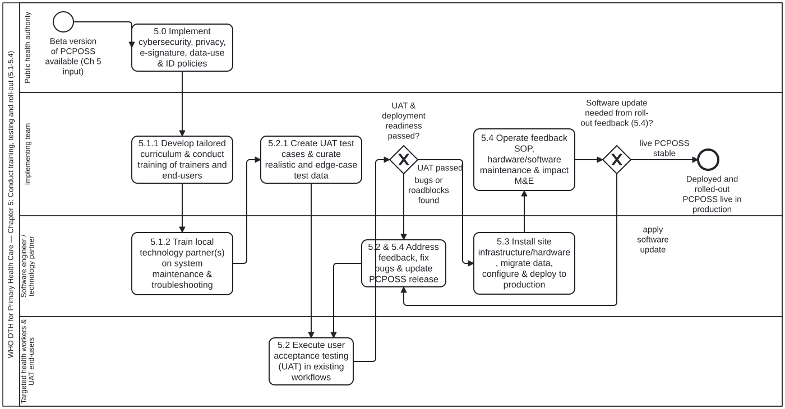
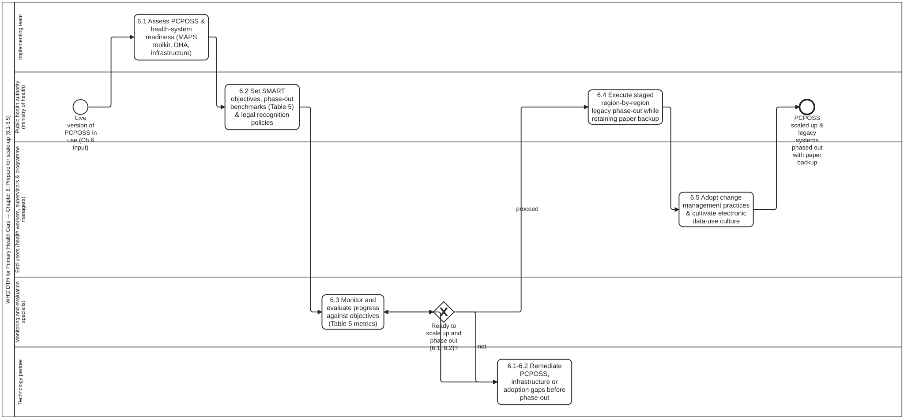

# BPMN 2.0 Process Models — Digitalizing Primary Health Care (PCPOSS)

This directory contains the five executable BPMN 2.0 process models (`omg-2013-bpmn-2-0-2`) and four DMN 1.5 decision tables (`omg-2024-dmn-1-5`, under [`decisions/`](decisions/)) formalized from the WHO handbook *Digitalizing primary health care: a handbook for planning and implementing point-of-service systems* (`9789240093362-eng`, `litlfred/dth-phc#1` Step P4b).

Each `.bpmn` diagram has:
- a deterministic, responsive `.svg` rendered beside it (`@litlfred/bootstrap-tools/scripts/render-bpmn.ts`), with `<bpmn:callActivity>` shapes linked to their called sub-process SVGs;
- a state-machine `.checklist.md` generated beside it (`cat-harness-tools/scripts/bpmn-checklist.ts`);
- swimlanes bound via `partitionElementRef` to `<bpmn:resource id="pers-...">` role definitions matching the 19 `persona` blocks in [`folio/dth-phc/ch02-getting-started/`](../folio/dth-phc/ch02-getting-started/);
- exclusive decision gateways bound via `<cat-harness.processes:decision ref="decisions/<file>.dmn#<Decision_Id>"/>` to DMN 1.5 decision tables; and
- a corresponding `business-process` (`smart-base:BusinessProcess`) block in `folio/dth-phc/`.

## Process Models

| Diagram | Process ID | Handbook Scope | Folio Block | Checklist |
|---|---|---|---|---|
| [`pcposs-implementation-lifecycle.bpmn`](pcposs-implementation-lifecycle.bpmn) | `Process_PcpossImplementationLifecycle` | Ch. 2 (2.1–2.4, Fig. 7): Starting-scenario assessment, team formation, DIIG alignment, 4 phase `callActivity` sub-processes, and agile iteration loop (MVP → Version 1 → Version 2) | [`bp:pcposs-implementation-lifecycle`](../folio/dth-phc/ch02-getting-started/bp-pcposs-implementation-lifecycle.ts) | [`pcposs-implementation-lifecycle.checklist.md`](pcposs-implementation-lifecycle.checklist.md) |
| [`understand-user-requirements.bpmn`](understand-user-requirements.bpmn) | `Process_UnderstandUserRequirements` | Ch. 3 (3.1–3.8): Stakeholder engagement, contextual observations & personas, BPMN workflow mapping, form inventory, indicator mapping, data-element minimization (`keep-data-element.dmn`), core data dictionary, user stories, decision-support logic, scheduling logic, NFRs & requirement prioritization (`requirement-priority.dmn`) | [`bp:understand-user-requirements`](../folio/dth-phc/ch03-understanding-user-requirements/bp-understand-user-requirements.ts) | [`understand-user-requirements.checklist.md`](understand-user-requirements.checklist.md) |
| [`design-and-adaptation.bpmn`](design-and-adaptation.bpmn) | `Process_DesignAndAdaptation` | Ch. 4 (4.1–4.5): Software/vendor selection, functional requirement validation, 3-stage prototype loop (wireframes, mock-ups, clickable prototype with end-user tests at each stage), system architecture & interoperability standards, software build & 7-part QA test suite | [`bp:design-and-adaptation`](../folio/dth-phc/ch04-design-and-adaptation/bp-design-and-adaptation.ts) | [`design-and-adaptation.checklist.md`](design-and-adaptation.checklist.md) |
| [`training-testing-and-roll-out.bpmn`](training-testing-and-roll-out.bpmn) | `Process_TrainingTestingAndRollOut` | Ch. 5 (5.0–5.4): Governance policies, parallel user/ToT training (5.1.1) and maintenance training (5.1.2), UAT preparation & execution (5.2), production deployment (5.3), feedback & maintenance loop (5.4) | [`bp:training-testing-and-roll-out`](../folio/dth-phc/ch05-training-testing-and-roll-out/bp-training-testing-and-roll-out.ts) | [`training-testing-and-roll-out.checklist.md`](training-testing-and-roll-out.checklist.md) |
| [`scale-up.bpmn`](scale-up.bpmn) | `Process_ScaleUp` | Ch. 6 (6.1–6.5): Readiness assessment (6.1), SMART objectives & Table 5 benchmarks (6.2), progress monitoring (6.3), scale-up readiness gateway (`ready-to-scale-up.dmn`), staged legacy phase-out with paper backup SOPs (6.4), change management & electronic data-use culture (6.5) | [`bp:scale-up`](../folio/dth-phc/ch06-scale-up/bp-scale-up.ts) | [`scale-up.checklist.md`](scale-up.checklist.md) |

## Rendered Diagrams

### 1. Top-level PCPOSS implementation lifecycle (`pcposs-implementation-lifecycle.svg`)

### 2. Phase 1 — Understanding user requirements (`understand-user-requirements.svg`)

### 3. Phase 2 — Design and adaptation (`design-and-adaptation.svg`)

### 4. Phase 3 — Training, testing and roll-out (`training-testing-and-roll-out.svg`)

### 5. Phase 4 — Scale-up (`scale-up.svg`)

